# S-01 & S-01b: Screen Specification & Implementation Guide

This document provides the complete UI/UX specification, component breakdown, design tokens, and production-ready React Native (Expo + NativeWind) code for the **01** PDF screens:
- `S-01 · Landing page.pdf` (The core mobile-first landing experience)
- `S-01b · Choose language (sheet).pdf` (The multilingual bottom sheet modal)

---

## 1. Visual & Design Token System

Extracted directly from the design mockups in `pdfs/S-01 · Landing page.pdf` and `pdfs/S-01b · Choose language (sheet).pdf`:

### 1.1 Color Palette
| Token Name | Hex Code | Usage |
| :--- | :--- | :--- |
| `primary-dark` | `#1A431E` | Bottom CTA Banner background, deep text |
| `primary` | `#2D6A2E` | Main action buttons ("Get started", "Done"), active radios |
| `primary-light` | `#E8F5E9` | AI pill badge background, Mina card background |
| `primary-subtle`| `#F4FBF4` | Card light accents, hover/pressed states |
| `surface-white` | `#FFFFFF` | Background of cards, input backgrounds, modal sheets |
| `bg-screen` | `#F8FAF8` | Overall page background (soft eco-mint/neutral) |
| `text-primary` | `#0F1E12` | Main headline ("Your waste has a price tag.") |
| `text-secondary`| `#4A5568` | Subtitles, descriptions, step captions |
| `text-muted` | `#718096` | Meta information, copyright, inactive labels |
| `border-light` | `#E2E8F0` | Dividers, card borders, unselected radio circles |
| `accent-gold` | `#D97706` | Escrow / badge subtle highlights if needed |

### 1.2 Typography & Sizing
- **Hero Title:** 36px–40px, ExtraBold / 800, tight tracking (`lineHeight: 44`)
- **Section Headers:** 22px–24px, Bold / 700
- **Body & Subtitles:** 15px–16px, Regular / 400 (`lineHeight: 22`)
- **Metric Numbers:** 24px–28px, Bold / 800
- **Badge & Small Labels:** 12px–13px, Medium / 600

---

## 2. Screen Anatomy: `S-01 · Landing page`

```mermaid
graph TD
    A[S-01 Header] --> B[Logo: EcoSmart AI]
    A --> C[Language Selector: EN ⌵]
    A --> D[Sign In Button]

    E[Hero Section] --> F[Live in Kubwa Badge]
    E --> G[Headline: Your waste has a price tag]
    E --> H[Get Started CTA + See how it works]
    E --> I[Interactive AI Scan Card Preview]

    J[Trust & Metrics] --> K[Kubwa Pilot Area]
    J --> L[₦0 Free to join]
    J --> M[100% Recyclers ID-checked]
    J --> N[Escrow Protection]

    O[Audience Segmentation] --> P[For Households >]
    O --> Q[For Recyclers >]

    R[How It Works] --> S[1. Scan or upload waste]
    R --> T[2. Get an instant price]
    R --> U[3. Recycle and earn]

    V[AI Capabilities Grid] --> W[6 Core AI Services]
    V --> X[24/7 AI Assistant: Ask Mina Banner]

    Y[Social Proof] --> Z[Adaeze O. Testimonial Card]

    AA[Conversion Footer] --> AB[Ready to turn waste into value? Banner]
    AA --> AC[Legal & Copyright Links]
```



---

## 3. Screen Breakdown & Components

### 3.1 Header (`LandingHeader.tsx`)
- **Left:** EcoSmart Logo (Leaf insignia + "EcoSmart AI" logotype).
- **Right Controls:**
  - **Language Pill:** Triggers the `S-01b` language modal. Shows globe icon, current language code (`EN`), and a down chevron.
  - **Sign In Button:** Pill button navigating to `app/(auth)/sign-in.tsx` (`S-08`).

### 3.2 Hero & AI Scan Result Mockup (`ScanPreviewCard.tsx`)
- Demonstrates what the user experiences immediately after scanning:
  - URL pill: `ecosmart.ai/scan-result`
  - Identification status: **"✓ Identified"**
  - Classified material: **"Plastic bottle (PET · Recyclable)"**
  - Estimated value: **"₦120–150/kg"**
  - Local demand: **"3 matched recyclers near you"**
  - Action button: **"Find a recycler nearby >"**
  - Carousel pagination indicators (3 dots).

### 3.3 Key Metrics Bar (`TrustMetrics.tsx`)
A 2x2 grid (or 4-column row on tablets/web) establishing trust in Kubwa:
1. **Kubwa:** Pilot area, Abuja.
2. **₦0:** Free to join.
3. **100%:** Recyclers ID-checked.
4. **Escrow:** Your money held safely.

### 3.4 Audience Cards (`AudienceCards.tsx`)
Directs users into their specific persona flow:
- **For households:** "Scan your waste, book a pickup, get paid." → Navigates to `app/(auth)/choose-account.tsx?role=household`.
- **For recyclers:** "Find waste near you, manage pickups, grow your business." → Navigates to `app/(auth)/choose-account.tsx?role=recycler`.

### 3.5 How It Works (`HowItWorksSteps.tsx`)
Numbered step cards with clean iconography:
1. **Scan or upload your waste:** "Take a photo. We tell you what it is."
2. **Get an instant price:** "See what it's worth and who buys it near you."
3. **Recycle and earn:** "A verified recycler weighs it and pays your wallet."

### 3.6 AI Features & "Ask Mina" (`MinaPromoCard.tsx`)
- 6 AI features chip grid:
  - ⛶ Waste ID
  - ✦ Material type
  - ₦ Value estimate
  - 📍 Recycler match
  - 📅 Pickup scheduling
  - 💬 AI assistant
- **"Ask Mina" Card:** Highlights the 24/7 AI chat agent that answers recycling questions and guides pickups.

### 3.7 Testimonial (`TestimonialCard.tsx`)
- Real Nigerian user quote:
  > *"I never knew my old bottles and newspapers were worth money. A Sunday clean-up turned into ₦6,400 in my wallet."*
- **Author:** Adaeze O. (Household · Kubwa) with carousel `<` and `>` controls.

### 3.8 Bottom CTA & Footer (`LandingFooter.tsx`)
- Forest green banner: "Ready to turn waste into value?"
- Buttons: "Get started" (Primary white) & "Sign in" (Secondary translucent).
- Links: Terms, Privacy, Help, Contact.
- Copyright: `© 2026 EcoSmart AI and Innovation Ltd. All rights reserved.`

---

## 4. Screen Anatomy: `S-01b · Choose language (sheet)`

When the user taps the language button in the header, an interactive bottom sheet slides up:

### Features:
- Drag handle indicator at top center.
- Heading: **"Choose language"**
- Subtext: **"You can change it any time in Settings."**
- Language Radio Options:
  1. **English** (Active default)
  2. **Pidgin**
  3. **Hausa**
  4. **Yoruba**
  5. **Igbo**
- Full-width CTA button: **"Done"** (Forest green `#2D6A2E`, rounded-2xl).
- Tapping "Done" or tapping the backdrop dismisses the sheet and persists the selection in `MMKV` / `AsyncStorage` and updates `i18next`.

---

## 5. Production React Native Implementation

### 5.1 Language Bottom Sheet (`components/sheets/LanguageBottomSheet.tsx`)

```tsx
import React, { useState } from 'react';
import { View, Text, TouchableOpacity, StyleSheet, Modal, Pressable } from 'react-native';
import { useTranslation } from 'react-i18next';

export interface LanguageOption {
  code: 'en' | 'pcm' | 'ha' | 'yo' | 'ig';
  label: string;
}

const LANGUAGES: LanguageOption[] = [
  { code: 'en', label: 'English' },
  { code: 'pcm', label: 'Pidgin' },
  { code: 'ha', label: 'Hausa' },
  { code: 'yo', label: 'Yoruba' },
  { code: 'ig', label: 'Igbo' },
];

interface Props {
  visible: boolean;
  onClose: () => void;
}

export const LanguageBottomSheet: React.FC<Props> = ({ visible, onClose }) => {
  const { i18n, t } = useTranslation();
  const [selectedLang, setSelectedLang] = useState<string>(i18n.language || 'en');

  const handleConfirm = () => {
    i18n.changeLanguage(selectedLang);
    onClose();
  };

  return (
    <Modal
      visible={visible}
      transparent
      animationType="slide"
      onRequestClose={onClose}
    >
      <Pressable style={styles.backdrop} onPress={onClose}>
        <Pressable style={styles.sheetContainer} onPress={(e) => e.stopPropagation()}>
          {/* Sheet Handle */}
          <View style={styles.dragHandle} />

          {/* Title & Description */}
          <Text style={styles.sheetTitle}>Choose language</Text>
          <Text style={styles.sheetSubtitle}>You can change it any time in Settings.</Text>

          {/* Radio List */}
          <View style={styles.list}>
            {LANGUAGES.map((lang) => {
              const isSelected = selectedLang === lang.code;
              return (
                <TouchableOpacity
                  key={lang.code}
                  style={styles.optionRow}
                  activeOpacity={0.7}
                  onPress={() => setSelectedLang(lang.code)}
                >
                  <Text style={[styles.optionLabel, isSelected && styles.optionLabelActive]}>
                    {lang.label}
                  </Text>
                  <View style={[styles.radioCircle, isSelected && styles.radioCircleActive]}>
                    {isSelected && <View style={styles.radioDot} />}
                  </View>
                </TouchableOpacity>
              );
            })}
          </View>

          {/* Confirm Button */}
          <TouchableOpacity style={styles.doneButton} onPress={handleConfirm} activeOpacity={0.85}>
            <Text style={styles.doneButtonText}>Done</Text>
          </TouchableOpacity>
        </Pressable>
      </Pressable>
    </Modal>
  );
};

const styles = StyleSheet.create({
  backdrop: {
    flex: 1,
    backgroundColor: 'rgba(0, 0, 0, 0.45)',
    justifyContent: 'flex-end',
  },
  sheetContainer: {
    backgroundColor: '#FFFFFF',
    borderTopLeftRadius: 28,
    borderTopRightRadius: 28,
    paddingHorizontal: 24,
    paddingTop: 12,
    paddingBottom: 40,
  },
  dragHandle: {
    width: 44,
    height: 5,
    backgroundColor: '#E2E8F0',
    borderRadius: 3,
    alignSelf: 'center',
    marginBottom: 20,
  },
  sheetTitle: {
    fontSize: 22,
    fontWeight: '700',
    color: '#0F1E12',
    marginBottom: 6,
  },
  sheetSubtitle: {
    fontSize: 14,
    color: '#64748B',
    marginBottom: 20,
  },
  list: {
    marginBottom: 24,
  },
  optionRow: {
    flexDirection: 'row',
    justifyContent: 'space-between',
    alignItems: 'center',
    paddingVertical: 15,
    borderBottomWidth: 1,
    borderBottomColor: '#F1F5F9',
  },
  optionLabel: {
    fontSize: 16,
    color: '#1E293B',
    fontWeight: '500',
  },
  optionLabelActive: {
    color: '#0F1E12',
    fontWeight: '600',
  },
  radioCircle: {
    width: 22,
    height: 22,
    borderRadius: 11,
    borderWidth: 2,
    borderColor: '#CBD5E1',
    alignItems: 'center',
    justifyContent: 'center',
  },
  radioCircleActive: {
    borderColor: '#2D6A2E',
  },
  radioDot: {
    width: 12,
    height: 12,
    borderRadius: 6,
    backgroundColor: '#2D6A2E',
  },
  doneButton: {
    backgroundColor: '#2D6A2E',
    height: 52,
    borderRadius: 26,
    alignItems: 'center',
    justifyContent: 'center',
  },
  doneButtonText: {
    color: '#FFFFFF',
    fontSize: 16,
    fontWeight: '700',
  },
});
```

---

### 5.2 Complete Landing Page Screen (`app/index.tsx`)

```tsx
import React, { useState } from 'react';
import {
  View,
  Text,
  ScrollView,
  TouchableOpacity,
  StyleSheet,
  SafeAreaView,
  StatusBar,
} from 'react-native';
import { useRouter } from 'expo-router';
import { Globe, ArrowRight, Camera, Zap, TrendingUp, Sparkles, MapPin, ShieldCheck, ChevronRight, MessageSquare, ChevronLeft } from 'lucide-react-native';
import { LanguageBottomSheet } from '../components/sheets/LanguageBottomSheet';

export default function LandingScreen() {
  const router = useRouter();
  const [langSheetVisible, setLangSheetVisible] = useState(false);

  return (
    <SafeAreaView style={styles.safeArea}>
      <StatusBar barStyle="dark-content" backgroundColor="#FFFFFF" />
      <ScrollView showsVerticalScrollIndicator={false} contentContainerStyle={styles.container}>

        {/* 1. TOP NAVBAR */}
        <View style={styles.navBar}>
          <View style={styles.logoRow}>
            <View style={styles.logoBadge}>
              <Sparkles size={16} color="#2D6A2E" />
            </View>
            <Text style={styles.logoText}>EcoSmart <Text style={styles.logoTextSub}>AI</Text></Text>
          </View>
          
          <View style={styles.navActions}>
            <TouchableOpacity
              style={styles.langPill}
              onPress={() => setLangSheetVisible(true)}
              activeOpacity={0.7}
            >
              <Globe size={15} color="#1E293B" />
              <Text style={styles.langPillText}>EN ⌵</Text>
            </TouchableOpacity>

            <TouchableOpacity
              style={styles.signInBtn}
              onPress={() => router.push('/(auth)/sign-in')}
              activeOpacity={0.7}
            >
              <Text style={styles.signInBtnText}>Sign in</Text>
            </TouchableOpacity>
          </View>
        </View>

        {/* 2. HERO SECTION */}
        <View style={styles.heroSection}>
          <View style={styles.kubwaBadge}>
            <Text style={styles.kubwaBadgeText}>🌱 AI-powered recycling · Live in Kubwa</Text>
          </View>

          <Text style={styles.heroTitle}>Your waste has{'\n'}a price tag.</Text>
          <Text style={styles.heroSubtitle}>
            Scan it. Know its worth. Get paid by a verified recycler near you.
          </Text>

          <TouchableOpacity
            style={styles.primaryCta}
            onPress={() => router.push('/(auth)/choose-account')}
            activeOpacity={0.85}
          >
            <Text style={styles.primaryCtaText}>Get started</Text>
          </TouchableOpacity>

          <TouchableOpacity style={styles.secondaryLink} activeOpacity={0.7}>
            <Text style={styles.secondaryLinkText}>See how it works →</Text>
          </TouchableOpacity>

          {/* Interactive Scan Card Simulation */}
          <View style={styles.scanCardPreview}>
            <View style={styles.scanBrowserBar}>
              <View style={styles.browserDots}>
                <View style={[styles.dot, { backgroundColor: '#EF4444' }]} />
                <View style={[styles.dot, { backgroundColor: '#F59E0B' }]} />
                <View style={[styles.dot, { backgroundColor: '#10B981' }]} />
              </View>
              <Text style={styles.browserUrl}>ecosmart.ai/scan-result</Text>
            </View>

            <View style={styles.scanBody}>
              <View style={styles.scanHeader}>
                <Text style={styles.scanLabel}>Scan result</Text>
                <View style={styles.identifiedPill}>
                  <Text style={styles.identifiedText}>✓ Identified</Text>
                </View>
              </View>

              <View style={styles.detectedBox}>
                <View style={styles.detectedInfo}>
                  <Text style={styles.detectedName}>Plastic bottle</Text>
                  <View style={styles.tagRow}>
                    <Text style={styles.tagPill}>PET</Text>
                    <Text style={styles.tagPill}>Recyclable</Text>
                  </View>
                </View>
              </View>

              <View style={styles.metricRow}>
                <View style={styles.metricCol}>
                  <Text style={styles.metricCaption}>Worth about</Text>
                  <Text style={styles.metricValue}>₦120–150/kg</Text>
                </View>
                <View style={styles.metricCol}>
                  <Text style={styles.metricCaption}>Recyclers near you</Text>
                  <Text style={styles.metricValue}>3 matched</Text>
                </View>
              </View>

              <TouchableOpacity style={styles.cardCta} activeOpacity={0.85}>
                <Text style={styles.cardCtaText}>Find a recycler nearby →</Text>
              </TouchableOpacity>
            </View>
          </View>
        </View>

        {/* 3. TRUST METRICS GRID */}
        <View style={styles.metricsGrid}>
          <View style={styles.metricCell}>
            <Text style={styles.metricCellTitle}>Kubwa</Text>
            <Text style={styles.metricCellSub}>Pilot area, Abuja</Text>
          </View>
          <View style={styles.metricCell}>
            <Text style={styles.metricCellTitle}>₦0</Text>
            <Text style={styles.metricCellSub}>Free to join</Text>
          </View>
          <View style={styles.metricCell}>
            <Text style={styles.metricCellTitle}>100%</Text>
            <Text style={styles.metricCellSub}>Recyclers ID-checked</Text>
          </View>
          <View style={styles.metricCell}>
            <Text style={styles.metricCellTitle}>Escrow</Text>
            <Text style={styles.metricCellSub}>Your money held safely</Text>
          </View>
        </View>

        {/* 4. AUDIENCE CARDS */}
        <View style={styles.section}>
          <Text style={styles.sectionHeader}>Built for everyone</Text>

          <TouchableOpacity style={styles.audienceCard} activeOpacity={0.8}>
            <View style={styles.audienceIconBox}>
              <Text style={{ fontSize: 22 }}>🏠</Text>
            </View>
            <View style={styles.audienceContent}>
              <Text style={styles.audienceTitle}>For households</Text>
              <Text style={styles.audienceSub}>Scan your waste, book a pickup, get paid.</Text>
            </View>
            <ChevronRight size={20} color="#94A3B8" />
          </TouchableOpacity>

          <TouchableOpacity style={styles.audienceCard} activeOpacity={0.8}>
            <View style={[styles.audienceIconBox, { backgroundColor: '#2D6A2E' }]}>
              <Text style={{ fontSize: 20, color: '#fff' }}>♻️</Text>
            </View>
            <View style={styles.audienceContent}>
              <Text style={styles.audienceTitle}>For recyclers</Text>
              <Text style={styles.audienceSub}>Find waste near you, manage pickups, grow your business.</Text>
            </View>
            <ChevronRight size={20} color="#94A3B8" />
          </TouchableOpacity>
        </View>

        {/* 5. HOW IT WORKS */}
        <View style={styles.section}>
          <Text style={styles.sectionHeader}>How it works</Text>

          <View style={styles.stepCard}>
            <View style={styles.stepNumberBadge}><Text style={styles.stepNumberText}>1</Text></View>
            <View style={styles.stepContent}>
              <Text style={styles.stepTitle}>Scan or upload your waste</Text>
              <Text style={styles.stepSub}>Take a photo. We tell you what it is.</Text>
            </View>
          </View>

          <View style={styles.stepCard}>
            <View style={styles.stepNumberBadge}><Text style={styles.stepNumberText}>2</Text></View>
            <View style={styles.stepContent}>
              <Text style={styles.stepTitle}>Get an instant price</Text>
              <Text style={styles.stepSub}>See what it’s worth and who buys it near you.</Text>
            </View>
          </View>

          <View style={styles.stepCard}>
            <View style={styles.stepNumberBadge}><Text style={styles.stepNumberText}>3</Text></View>
            <View style={styles.stepContent}>
              <Text style={styles.stepTitle}>Recycle and earn</Text>
              <Text style={styles.stepSub}>A verified recycler weighs it and pays your wallet.</Text>
            </View>
          </View>
        </View>

        {/* 6. ASK MINA AI BANNER */}
        <View style={styles.minaCard}>
          <View style={styles.minaAvatarCircle}>
            <Text style={{ fontSize: 32 }}>🤖</Text>
          </View>
          <View style={styles.minaContent}>
            <Text style={styles.minaTag}>24/7 AI assistant</Text>
            <Text style={styles.minaTitle}>Ask Mina</Text>
            <Text style={styles.minaDesc}>
              Mina answers questions, identifies recyclables, explains prices and guides your pickups.
            </Text>
          </View>
        </View>

        {/* 7. TESTIMONIAL */}
        <View style={styles.testimonialCard}>
          <Text style={styles.quoteIcon}>“</Text>
          <Text style={styles.quoteText}>
            I never knew my old bottles and newspapers were worth money. A Sunday clean-up turned into ₦6,400 in my wallet.
          </Text>
          <View style={styles.authorRow}>
            <View style={styles.authorAvatar}>
              <Text style={styles.authorInitial}>A</Text>
            </View>
            <View style={{ flex: 1 }}>
              <Text style={styles.authorName}>Adaeze O.</Text>
              <Text style={styles.authorMeta}>Household · Kubwa</Text>
            </View>
            <View style={styles.chevronControls}>
              <TouchableOpacity style={styles.navChevron}><ChevronLeft size={18} color="#64748B" /></TouchableOpacity>
              <TouchableOpacity style={styles.navChevron}><ChevronRight size={18} color="#64748B" /></TouchableOpacity>
            </View>
          </View>
        </View>

        {/* 8. BOTTOM CONVERSION BANNER */}
        <View style={styles.ctaBanner}>
          <Text style={styles.ctaBannerTitle}>Ready to turn waste into value?</Text>
          <Text style={styles.ctaBannerSubtitle}>
            Join households and recyclers in Kubwa building a cleaner city.
          </Text>

          <TouchableOpacity style={styles.ctaBannerPrimaryBtn} onPress={() => router.push('/(auth)/choose-account')}>
            <Text style={styles.ctaBannerPrimaryText}>Get started</Text>
          </TouchableOpacity>

          <TouchableOpacity style={styles.ctaBannerSecondaryBtn} onPress={() => router.push('/(auth)/sign-in')}>
            <Text style={styles.ctaBannerSecondaryText}>Sign in</Text>
          </TouchableOpacity>
        </View>

        {/* 9. FOOTER */}
        <View style={styles.footer}>
          <View style={styles.footerLinks}>
            <Text style={styles.footerLink}>Terms</Text>
            <Text style={styles.footerLink}>Privacy</Text>
            <Text style={styles.footerLink}>Help</Text>
            <Text style={styles.footerLink}>Contact</Text>
          </View>
          <Text style={styles.copyright}>
            © 2026 EcoSmart AI and Innovation Ltd. All rights reserved.
          </Text>
        </View>

      </ScrollView>

      {/* Language Bottom Sheet Modal */}
      <LanguageBottomSheet
        visible={langSheetVisible}
        onClose={() => setLangSheetVisible(false)}
      />
    </SafeAreaView>
  );
}

const styles = StyleSheet.create({
  safeArea: { flex: 1, backgroundColor: '#FFFFFF' },
  container: { paddingBottom: 40 },
  navBar: {
    flexDirection: 'row',
    justifyContent: 'space-between',
    alignItems: 'center',
    paddingHorizontal: 20,
    paddingVertical: 14,
  },
  logoRow: { flexDirection: 'row', alignItems: 'center', gap: 6 },
  logoBadge: {
    width: 28,
    height: 28,
    borderRadius: 14,
    backgroundColor: '#E8F5E9',
    alignItems: 'center',
    justifyContent: 'center',
  },
  logoText: { fontSize: 18, fontWeight: '800', color: '#1B4323' },
  logoTextSub: { color: '#2D6A2E' },
  navActions: { flexDirection: 'row', alignItems: 'center', gap: 10 },
  langPill: {
    flexDirection: 'row',
    alignItems: 'center',
    gap: 4,
    paddingHorizontal: 10,
    paddingVertical: 6,
    borderRadius: 16,
    borderWidth: 1,
    borderColor: '#E2E8F0',
  },
  langPillText: { fontSize: 13, fontWeight: '600', color: '#1E293B' },
  signInBtn: {
    paddingHorizontal: 14,
    paddingVertical: 6,
    borderRadius: 16,
    borderWidth: 1,
    borderColor: '#0F1E12',
  },
  signInBtnText: { fontSize: 13, fontWeight: '600', color: '#0F1E12' },

  heroSection: { alignItems: 'center', paddingHorizontal: 20, paddingTop: 16 },
  kubwaBadge: {
    backgroundColor: '#EAF5EA',
    paddingHorizontal: 14,
    paddingVertical: 6,
    borderRadius: 20,
    marginBottom: 16,
  },
  kubwaBadgeText: { color: '#2D6A2E', fontSize: 13, fontWeight: '600' },
  heroTitle: {
    fontSize: 36,
    fontWeight: '800',
    color: '#0F1E12',
    textAlign: 'center',
    lineHeight: 42,
    marginBottom: 12,
  },
  heroSubtitle: {
    fontSize: 16,
    color: '#475569',
    textAlign: 'center',
    lineHeight: 22,
    marginBottom: 20,
    paddingHorizontal: 10,
  },
  primaryCta: {
    backgroundColor: '#2D6A2E',
    width: '100%',
    height: 52,
    borderRadius: 26,
    alignItems: 'center',
    justifyContent: 'center',
    marginBottom: 14,
  },
  primaryCtaText: { color: '#FFFFFF', fontSize: 17, fontWeight: '700' },
  secondaryLink: { marginBottom: 26 },
  secondaryLinkText: { color: '#2D6A2E', fontSize: 15, fontWeight: '600' },

  scanCardPreview: {
    width: '100%',
    backgroundColor: '#FFFFFF',
    borderRadius: 20,
    borderWidth: 1,
    borderColor: '#E2E8F0',
    shadowColor: '#000',
    shadowOffset: { width: 0, height: 4 },
    shadowOpacity: 0.08,
    shadowRadius: 12,
    elevation: 4,
    overflow: 'hidden',
    marginBottom: 28,
  },
  scanBrowserBar: {
    flexDirection: 'row',
    alignItems: 'center',
    backgroundColor: '#F8FAFC',
    paddingHorizontal: 14,
    paddingVertical: 8,
    borderBottomWidth: 1,
    borderBottomColor: '#F1F5F9',
  },
  browserDots: { flexDirection: 'row', gap: 5, marginRight: 12 },
  dot: { width: 8, height: 8, borderRadius: 4 },
  browserUrl: { fontSize: 12, color: '#64748B' },
  scanBody: { padding: 16 },
  scanHeader: { flexDirection: 'row', justifyContent: 'space-between', alignItems: 'center', marginBottom: 12 },
  scanLabel: { fontSize: 15, fontWeight: '700', color: '#1E293B' },
  identifiedPill: { backgroundColor: '#DCFCE7', paddingHorizontal: 10, paddingVertical: 4, borderRadius: 12 },
  identifiedText: { color: '#15803D', fontSize: 12, fontWeight: '600' },
  detectedBox: { backgroundColor: '#F0FDF4', padding: 12, borderRadius: 12, marginBottom: 14 },
  detectedInfo: { gap: 6 },
  detectedName: { fontSize: 16, fontWeight: '700', color: '#14532D' },
  tagRow: { flexDirection: 'row', gap: 6 },
  tagPill: { backgroundColor: '#FFFFFF', paddingHorizontal: 8, paddingVertical: 2, borderRadius: 8, fontSize: 11, color: '#15803D', fontWeight: '600' },
  metricRow: { flexDirection: 'row', justifyContent: 'space-between', marginBottom: 16 },
  metricCol: { flex: 1 },
  metricCaption: { fontSize: 12, color: '#64748B' },
  metricValue: { fontSize: 16, fontWeight: '800', color: '#0F172A', marginTop: 2 },
  cardCta: { backgroundColor: '#2D6A2E', paddingVertical: 12, borderRadius: 12, alignItems: 'center' },
  cardCtaText: { color: '#FFFFFF', fontWeight: '700', fontSize: 14 },

  metricsGrid: {
    flexDirection: 'row',
    flexWrap: 'wrap',
    borderTopWidth: 1,
    borderBottomWidth: 1,
    borderColor: '#F1F5F9',
    marginVertical: 16,
  },
  metricCell: { width: '50%', padding: 20, alignItems: 'center', borderRightWidth: 1, borderColor: '#F1F5F9' },
  metricCellTitle: { fontSize: 24, fontWeight: '800', color: '#0F1E12' },
  metricCellSub: { fontSize: 13, color: '#64748B', marginTop: 4 },

  section: { paddingHorizontal: 20, marginVertical: 16 },
  sectionHeader: { fontSize: 22, fontWeight: '800', color: '#0F1E12', marginBottom: 16 },
  audienceCard: {
    flexDirection: 'row',
    alignItems: 'center',
    padding: 16,
    borderRadius: 16,
    borderWidth: 1,
    borderColor: '#E2E8F0',
    marginBottom: 12,
  },
  audienceIconBox: { width: 44, height: 44, borderRadius: 12, backgroundColor: '#E8F5E9', alignItems: 'center', justifyContent: 'center' },
  audienceContent: { flex: 1, marginLeft: 14 },
  audienceTitle: { fontSize: 16, fontWeight: '700', color: '#0F1E12' },
  audienceSub: { fontSize: 13, color: '#64748B', marginTop: 2 },

  stepCard: {
    flexDirection: 'row',
    alignItems: 'center',
    padding: 16,
    borderRadius: 14,
    borderWidth: 1,
    borderColor: '#F1F5F9',
    marginBottom: 10,
    backgroundColor: '#FAFAFA',
  },
  stepNumberBadge: { width: 32, height: 32, borderRadius: 16, backgroundColor: '#2D6A2E', alignItems: 'center', justifyContent: 'center' },
  stepNumberText: { color: '#FFFFFF', fontWeight: '700' },
  stepContent: { marginLeft: 14, flex: 1 },
  stepTitle: { fontSize: 15, fontWeight: '700', color: '#0F1E12' },
  stepSub: { fontSize: 13, color: '#64748B', marginTop: 2 },

  minaCard: {
    flexDirection: 'row',
    backgroundColor: '#F1F8E9',
    marginHorizontal: 20,
    padding: 18,
    borderRadius: 20,
    marginVertical: 16,
    alignItems: 'center',
  },
  minaAvatarCircle: { width: 64, height: 64, borderRadius: 32, backgroundColor: '#FFFFFF', alignItems: 'center', justifyContent: 'center' },
  minaContent: { flex: 1, marginLeft: 14 },
  minaTag: { fontSize: 12, fontWeight: '700', color: '#2D6A2E', textTransform: 'uppercase' },
  minaTitle: { fontSize: 18, fontWeight: '800', color: '#0F1E12', marginVertical: 2 },
  minaDesc: { fontSize: 13, color: '#4A5568', lineHeight: 18 },

  testimonialCard: {
    marginHorizontal: 20,
    padding: 20,
    borderRadius: 20,
    borderWidth: 1,
    borderColor: '#E2E8F0',
    marginVertical: 16,
  },
  quoteIcon: { fontSize: 32, color: '#2D6A2E', fontWeight: '900' },
  quoteText: { fontSize: 15, color: '#1E293B', lineHeight: 22, marginVertical: 8 },
  authorRow: { flexDirection: 'row', alignItems: 'center', marginTop: 12 },
  authorAvatar: { width: 36, height: 36, borderRadius: 18, backgroundColor: '#DCFCE7', alignItems: 'center', justifyContent: 'center', marginRight: 10 },
  authorInitial: { color: '#15803D', fontWeight: '700', fontSize: 16 },
  authorName: { fontSize: 14, fontWeight: '700', color: '#0F1E12' },
  authorMeta: { fontSize: 12, color: '#64748B' },
  chevronControls: { flexDirection: 'row', gap: 6 },
  navChevron: { padding: 6, borderRadius: 16, backgroundColor: '#F1F5F9' },

  ctaBanner: {
    backgroundColor: '#1A431E',
    marginHorizontal: 20,
    borderRadius: 24,
    padding: 24,
    alignItems: 'center',
    marginVertical: 20,
  },
  ctaBannerTitle: { fontSize: 22, fontWeight: '800', color: '#FFFFFF', textAlign: 'center', marginBottom: 8 },
  ctaBannerSubtitle: { fontSize: 14, color: '#A7D7A9', textAlign: 'center', marginBottom: 20, lineHeight: 20 },
  ctaBannerPrimaryBtn: {
    backgroundColor: '#FFFFFF',
    width: '100%',
    height: 50,
    borderRadius: 25,
    alignItems: 'center',
    justifyContent: 'center',
    marginBottom: 10,
  },
  ctaBannerPrimaryText: { color: '#1A431E', fontSize: 16, fontWeight: '700' },
  ctaBannerSecondaryBtn: {
    borderWidth: 1,
    borderColor: '#A7D7A9',
    width: '100%',
    height: 50,
    borderRadius: 25,
    alignItems: 'center',
    justifyContent: 'center',
  },
  ctaBannerSecondaryText: { color: '#FFFFFF', fontSize: 16, fontWeight: '600' },

  footer: { alignItems: 'center', marginTop: 16, paddingHorizontal: 20 },
  footerLinks: { flexDirection: 'row', gap: 16, marginBottom: 12 },
  footerLink: { fontSize: 13, color: '#64748B', fontWeight: '500' },
  copyright: { fontSize: 12, color: '#94A3B8', textAlign: 'center' },
});
```
